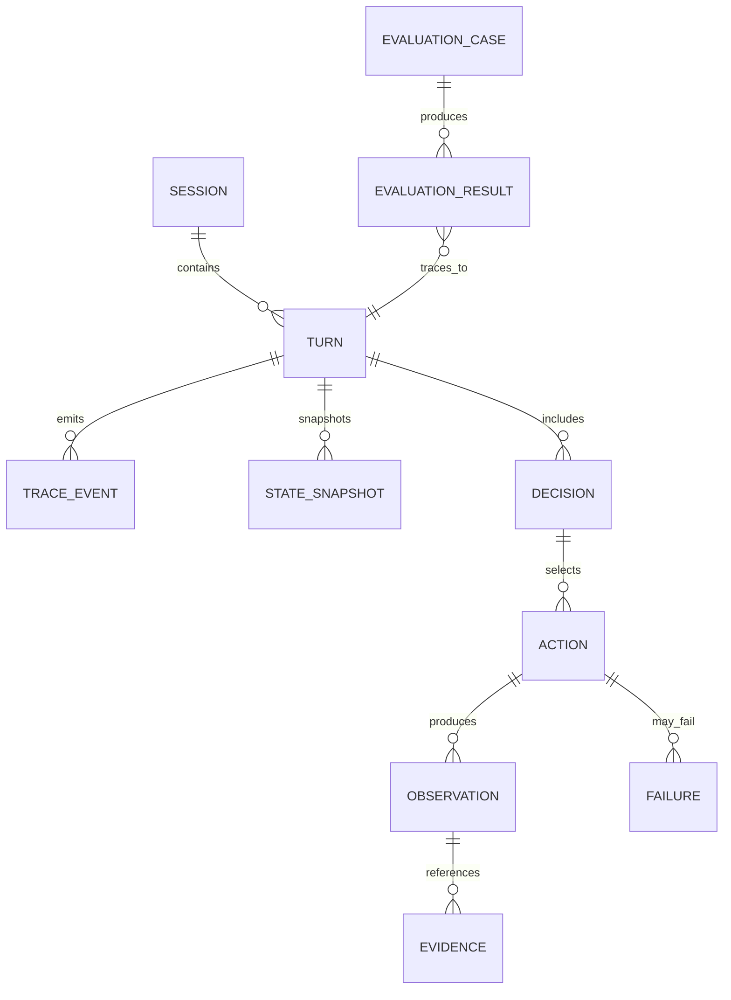

# DATABASE.md — Database Architecture and Data Model

## 1. Storage responsibilities

### Implemented Neo4j interface (2026-10-09)

See `NEO4J_GUIDE.md` for the shared async driver, client, bounded domain repositories, environment
switching, tests and actual source-schema mapping. The supplied revised graph inventory and local
inspection use PlantDetails/PlantAlias/PlantPart/TherapeuticUse, not the older illustrative names.
Local inspection found only two lookup indexes and no constraints. No schema changes were made.
The logical diagrams below remain conceptual; queries use only the verified physical model.

```text
PostgreSQL → durable application/orchestration/evidence/trace/evaluation data
Redis      → transient/cache/coordination
Neo4j      → knowledge graph
Qdrant     → vector retrieval
```

PostgreSQL is the durable application/evaluation source of truth.

## 2. PostgreSQL logical domains

The durable model must represent:

- sessions/conversations,
- turns,
- orchestration state/checkpoint data as required,
- observations,
- actions,
- decisions,
- failures/retries,
- evidence/provenance,
- trace events,
- state snapshots,
- evaluation cases/results.

The exact physical table names and migration implementation are not frozen until the repository scaffold is finalized.

## 3. Session/turn data

Logical session information includes:

```text
session_id
mode: discovery | conversation
active plant/context
session/task status
```

Logical turn correlation includes:

```text
session_id
turn_id
run_id
mode
status
user input reference
```

Avoid storing large raw uploads directly in trace rows unless explicitly required.

## 4. Trace event model

A domain trace event should be able to represent:

```text
event_id
run_id
session_id
turn_id
parent_event_id
event_type
component
action
timestamp
input_snapshot (sanitized)
output_snapshot (sanitized)
state_before snapshot/reference
state_after snapshot/reference
decision_id
action_id
agent_invocation_id
latency_ms
token_usage when available
success
error when applicable
evidence_refs
provenance_refs
```

The event store is for behavioral evaluation, not only diagnostics.

## 5. Trace event vocabulary

At minimum support stable representations of:

```text
SESSION_CREATED
TURN_STARTED
GOAL_ASSESSED
HYPOTHESIS_CREATED
HYPOTHESIS_UPDATED
HYPOTHESIS_REJECTED
ACTION_CANDIDATE_GENERATED
DECISION_MADE
AGENT_INVOCATION_STARTED
AGENT_INVOCATION_COMPLETED
AGENT_INVOCATION_FAILED
TOOL_CALL_STARTED
TOOL_CALL_COMPLETED
TOOL_CALL_FAILED
PARALLEL_EXECUTION_STARTED
PARALLEL_BRANCH_COMPLETED
PARALLEL_BRANCH_CANCELLED
OBSERVATION_CREATED
EVIDENCE_ADDED
EVIDENCE_EVALUATED
EVIDENCE_GAP_DETECTED
CONTRADICTION_DETECTED
BELIEF_UPDATED
ENTITY_REASSESSED
RETRY_STARTED
RETRY_COMPLETED
CLARIFICATION_REQUESTED
USER_INTERRUPTED
EXECUTION_RESUMED
TERMINATION_CHECKED
TERMINATION_REACHED
RESPONSE_CONTEXT_BUILT
FINAL_LLM_STARTED
FINAL_LLM_COMPLETED
RESPONSE_STREAM_STARTED
RESPONSE_STREAM_COMPLETED
TURN_COMPLETED
```

Keep names stable after evaluation tooling depends on them.

## 6. State snapshots

Every orchestration iteration must be reconstructable through a lightweight state snapshot/reference containing at least:

```text
run_id
session_id
turn_id
iteration
state_before/reference
state_after/reference
```

Do not duplicate massive state payloads unnecessarily.

## 7. Observation data

Logical fields:

```text
observation_id
agent/component
observation_type
payload
confidence
evidence_refs
provenance_refs
```

## 8. Decision/action data

Logical decision fields established by the design include:

```text
decision_id
action
reason
capability
inputs
expected_information_gain
priority
dependencies
stopping_conditions
```

Action history should preserve attempts/status and links to observations/failures/retries.

## 9. Failure/retry data

Logical failure fields:

```text
action_id
error_type
retryable
reason
metadata
```

Persist enough information to evaluate retry success and budget exhaustion.

## 10. Evidence

Logical evidence record:

```text
evidence_id
source_id
source_type
claim
evidence_type
source_quality
confidence
supports
contradicts
provenance
recency when relevant
```

Evidence classes:

```text
traditional
preclinical
in-vitro
animal
clinical
mechanistic
established
unknown
```

Do not permit generation to promote these values.

## 11. Evaluation records

Evaluation data must link:

```text
evaluation case/dataset
expected behavior/answer
run_id / trace lineage
metric/result values
pass/fail or score
```

Exact benchmark schema is `TODO / DECISION REQUIRED`.

## 12. Neo4j logical graph

Entities:

```text
Plant
PlantPart
Phytochemical
TherapeuticUse
Bioactivity
ProteinTarget
Document
```

Relationships:

```text
Plant -[:HAS_PART]-> PlantPart
PlantPart -[:CONTAINS]-> Phytochemical
PlantPart -[:USED_FOR]-> TherapeuticUse
Phytochemical -[:HAS_BIOACTIVITY]-> Bioactivity
Bioactivity -[:MEASURED_ON]-> ProteinTarget
Bioactivity -[:REPORTED_IN]-> Document
Phytochemical -[:REPORTED_IN]-> Document
Plant -[:REPORTED_IN]-> Document
TherapeuticUse -[:SUPPORTED_BY]-> Document
```

Where supplied source data supports it, relationships may include provenance such as:

```json
{
  "confidence": 0.94,
  "evidence_type": "in-vitro",
  "document_id": "DOC_123",
  "source_system": "ingestion_2026_08",
  "assertion_version": 3
}
```

Use stable IDs for joins. Names are display attributes.

## 13. Supported graph query types

```text
GET_PLANT_DETAILS
GET_PLANT_PARTS
GET_PLANT_PART_DETAILS
GET_PHYTOCHEMICALS
GET_PHYTOCHEMICAL_DETAILS
GET_BIOACTIVITY
GET_PROTEIN_TARGETS
GET_THERAPEUTIC_USES
GET_DOCUMENTS
GET_EVIDENCE
GET_PLANTS_CONTAINING_COMPOUND
GET_COMPOUNDS_TARGETING_PROTEIN
GET_PLANTS_FOR_THERAPEUTIC_USE
COMPARE_PLANTS
TRACE_EVIDENCE
```

Each type maps to a controlled query implementation.

## 14. Graph safety

Every graph operation requires:

```text
typed query object
→ allow-list
→ validated parameters
→ parameterized Cypher
→ bounded result size
→ timeout
→ read-only credentials
```

Never send raw user/model text to Neo4j.

## 15. Qdrant

Used for image/vector retrieval:

- embeddings,
- visual similarity,
- candidate retrieval.

Exact collection name, vector dimension, distance metric and payload schema depend on the selected model and are `TODO / DECISION REQUIRED`.

## 16. Redis

Used for:

- short-lived execution state,
- caching,
- request deduplication,
- rate limiting,
- optional locks/semaphores.

Do not use Redis as durable authority for trace/evidence/application records.

## 17. PostgreSQL entity search

Use the established resolution cascade where appropriate:

```text
PostgreSQL FTS
→ pg_trgm
→ RapidFuzz
```

Add indexes based on actual lookup patterns/benchmarks.

## 18. Transactions

Use transactions when a set of related durable application writes must remain consistent.

The trace side channel is intentionally independent; the main task must not wait for the trace transaction.

## 19. Migrations

All schema changes must be migration-backed.

The exact migration technology is `TODO / DECISION REQUIRED` if not already present in the repository.

Do not rely on implicit startup auto-schema creation as the permanent solution.

## 20. Data lifecycle

`TODO / DECISION REQUIRED`:

- trace retention,
- state snapshot pruning,
- evaluation dataset retention,
- session deletion behavior,
- image-upload lifecycle,
- raw vs redacted trace content.

## 21. Backup/reproducibility

Production backup infrastructure is outside the one-month scope, but data/seed ingestion should be reproducible enough to rebuild local stores for evaluation.

## 22. Logical ER model



This is a logical model, not a frozen SQL schema.

## Search/application stores implemented (2026-10-10)

PostgreSQL uses one asyncpg pool with explicit read/write transactions and safe parameter binding.
Versioned migrations in `backend/database/postgres/migrations` create pg_trgm, search generations,
plant/name/entity projections, sessions/turns, trace events and evaluation records. Evidence and
belief state remain typed JSON snapshots within session/turn records. Qdrant stores 384-dimensional
multilingual MiniLM name vectors with generation filters and source metadata. Explicit `search_admin`
commands migrate, populate and check health; startup does not mutate schema. Cloud/local connection
values are configured only through .env. See TEXT_ENTITY_GUIDE.md for schema lifecycle and recovery.

## Durable runtime checkpoints

The explicit search_admin migrate command also runs the official LangGraph PostgreSQL checkpoint
migrations. Startup performs a readiness query only. A dedicated reusable psycopg connection with
strict contract serialization serves checkpoints; asyncpg remains the application/trace pool.
Use python -m backend on Windows for the compatible event loop. See HARNESS_GUIDE.md.
