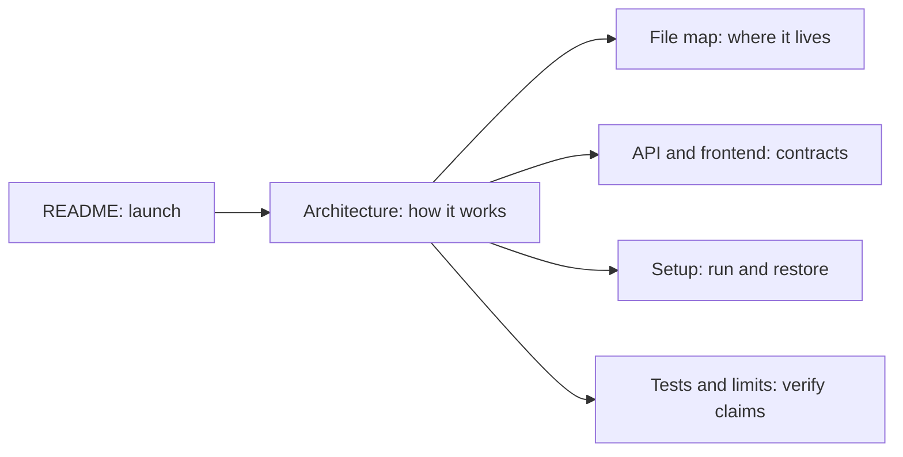

# IMPARK documentation

These pages describe the **current inspected implementation**. Start with the root [README](../README.md) to run the demo, then follow the reference that matches your task:

| Page | Read it for |
| --- | --- |
| [Implemented architecture](architecture/README.md) | Component boundaries, DeepAgents and LangGraph interaction, turn lifecycle, evidence and operational limits. |
| [Repository/file map](repository-map/README.md) | The purpose of every major folder and relevant source/config/test file. |
| [API and frontend](api-and-frontend/README.md) | All versioned routes, Pydantic contracts, SSE replay, error states and Next.js ownership. |
| [Setup and operations](setup-and-operations/README.md) | Python/Node/Docker/Ollama setup, data stores, model artifacts, explicit migrations/indexes, run and cold handoff. |
| [Testing and limitations](testing-and-limitations/README.md) | Test suite map, live-test flags, trace/evaluation scope, and claims that code cannot establish. |
| [DeepAgents runtime](../backend/orchestrator/deepagents/README.md) | Role configuration, context, retrieval coverage, answer repair, and fallback in the current agent implementation. |
| [Evaluator & Observability](../evaluator/README.md) | Self-hosted, decoupled multi-agent evaluation pipeline (Arize Phoenix + Gemma 4 judge, Redis Streams queue, PostgreSQL persistence). |
| [Frontend guide](../frontend/README.md) | UI flow and component-level integration details. |

The active composition root is [`backend/main.py`](../backend/main.py). The actual HTTP schema is generated by FastAPI at `/openapi.json`; `frontend/contracts/openapi.json` is a committed snapshot. The runtime's main agent is a DeepAgents orchestrator with exactly three specialist subagents, and the outer LangGraph handles checkpointed clarification. Older dated delivery reports and design proposals may describe the superseded deterministic harness; their historical status is marked at the top. Current behavior should be checked against the code and the pages above.

