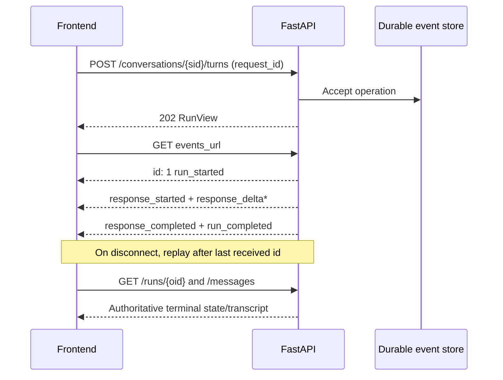

# API, contracts, and frontend integration

The authoritative HTTP implementation is [`backend/api/routes/platform.py`](../../backend/api/routes/platform.py), its Pydantic models are in [`backend/api/schemas/platform.py`](../../backend/api/schemas/platform.py) and [`chat.py`](../../backend/api/schemas/chat.py), and the generated snapshot is [`frontend/contracts/openapi.json`](../../frontend/contracts/openapi.json). The snapshot can be regenerated with `python -m backend.api.export_contracts`; the live `/openapi.json` is definitive for a running build. This is a **single-user demo workspace**, not an account-isolated multi-user API.

## HTTP surface

Every route below is prefixed `/api/v1`. IDs in path/body are UUIDs unless otherwise indicated. The router requires `Authorization: Bearer <API_KEY>` when configured. Without a key, access is allowed only when `APPLICATION_ENV=development` and `ENABLE_DEVELOPMENT_API=true`; otherwise it returns 403. `X-Correlation-ID` is exposed in responses. Pagination accepts `limit` 1–100 and `offset` 0–100000.

| Method and path | Request | Response / purpose |
| --- | --- | --- |
| `GET /capabilities` | none | API version, single-user/one-plant flags, image availability, limits, model/policy metadata. |
| `POST /conversations` | `SessionCreate {title?}` | 201 `SessionSummary`; creates discovery session. |
| `GET /conversations` | `archived?`, `limit?`, `offset?` | `SessionPage {items,next_offset}`. |
| `GET /conversations/{sid}` | none | `SessionSummary` including public chat state. |
| `PATCH /conversations/{sid}` | `SessionPatch {title?,archived?}` | Updated summary. |
| `DELETE /conversations/{sid}` | none | 204; conflicts with an active/interrupted operation. |
| `GET /conversations/{sid}/messages` | pagination | `MessagePage`, durable user/assistant transcript. |
| `POST /conversations/{sid}/turns` | `TurnCreate` | 202 `RunView`; asynchronous, idempotent by `request_id` and payload. |
| `POST /conversations/{sid}/clarifications` | `ClarificationCreate` | 202 `RunView`; resumes pending discovery with matching clarification ID. |
| `GET /discovery/autocomplete?q=...` | 1–200-character query | `AutocompleteResponse`; direct catalog/search path. |
| `GET /runs/{oid}` | none | Current `RunView`. |
| `POST /runs/{oid}/cancel` | none | Cancels or returns terminal run. |
| `POST /runs/{oid}/resume` | none | 202, only for `interrupted` runs. |
| `GET /runs/{oid}/events` | `after?` or `Last-Event-ID` | Replayable `text/event-stream`. |
| `GET /runs/{oid}/evidence` | none | Evidence attached to this answer; resolves cited prior-turn evidence within the same session. |
| `POST /conversations/{sid}/images` | raw PNG/JPEG/WebP bytes and matching Content-Type | 201 `ImageReference`; image belongs to the session. |
| `GET /conversations/{sid}/images` | none | Registered image metadata. |
| `GET /conversations/{sid}/images/{iid}` | none | Private image bytes, `no-store` and `nosniff`. |
| `DELETE /conversations/{sid}/images/{iid}` | none | 204, rejected during an active run. |

`GET /health`, `/health/postgres`, `/health/qdrant`, `/health/neo4j`, and `/health/llm` live outside `/api/v1`. The separate `/dev` conversation/image/trace routes exist only behind the development authorization dependency and are not the frontend contract.

## Contract semantics

`TurnCreate` extends `ChatRequest`: required `request_id`, plus at least one of nonempty `text` (maximum 8000 characters), `image_id`, or `selected_plant_id`. The image must already have been uploaded into this session. A selected plant is checked against the catalog. `ClarificationCreate` contains a new `request_id`, the pending `clarification_id`, optional text/selection/image, and resumes the existing checkpoint. Do not create a second chat when clarifying. `SessionSummary.state` is `ChatResponse` with `mode`, `status`, `active_plant`, optional clarification/response/understanding/image-understanding, correlation metadata, and the one-plant notice. The session state is authoritative after refresh; the frontend should not infer plant identity solely from message text.

`RunView.status` is one of `accepted`, `running`, `interrupted`, `complete`, `cancelled`, `failed`. `RunView.events_url` points to its stream. `StreamEvent` has version 1, operation ID, monotonically increasing sequence, type, and payload. Types implemented by the schema are `run_started`, `progress`, `response_started`, `response_delta`, `response_reset`, `response_completed`, `clarification_requested`, `run_completed`, `run_failed`, `run_cancelled`, `run_interrupted`. The SSE frame repeats the sequence as `id`, type as `event`, and JSON envelope as `data`; a heartbeat comment is emitted while idle. Reconnect with `Last-Event-ID` or `after`; a cursor ahead of the run is rejected. The stream ends after a terminal status and a final tail read. A reset means discard prior partial answer before consuming new deltas. Persisted run and message state should settle the UI after a disconnect, failed stream, or reload.

An HTTP error body is `ErrorResponse {code,message,correlation_id}`. Validation errors return 422 without echoing submitted values. Common domain cases include `UNAUTHORIZED` (401), `FORBIDDEN` (403), `NOT_FOUND` (404), `CONFLICT`/`PLANT_SCOPE_LOCKED` (409), `IMAGE_TOO_LARGE` (413), `INVALID_INPUT`/`INVALID_CURSOR` (422), `BUSY` (429), and `UNAVAILABLE` (503). `RunManager` can also persist a failed run with `error_code`; do not mistake an HTTP 202 acceptance for final success.

## Next.js ownership

The browser uses the same-origin catch-all [`frontend/app/api/v1/[...path]/route.ts`](../../frontend/app/api/v1/%5B...path%5D/route.ts), which forwards requests to `BACKEND_URL` and adds the server-side `BACKEND_API_KEY` when set. The key must never be put in client JavaScript. [`frontend/api/client.mjs`](../../frontend/api/client.mjs) handles requests, SSE framing/replay and idempotency; [`frontend/src/api.ts`](../../frontend/src/api.ts) exposes typed UI operations. [`frontend/src/App.tsx`](../../frontend/src/App.tsx) coordinates routing, session restoration, run progress and sidebar state. The landing route is `frontend/app/page.tsx`; `/chat/[id]` is the chat route. `Discovery`, `Clarification`, and `Conversation` components present the mode-specific interactions; `Evidence` resolves numbered citations to the run's evidence items and attached source URLs; `Sidebar` lists/archives/deletes chats. `sessionPages.mjs` handles paginated sidebar refreshes. `types.ts` mirrors the API shapes; `styles.css` owns responsive styling.

The UI should: (1) create/load a session; (2) use autocomplete without treating a suggestion as confirmed; (3) upload an image before referencing its ID; (4) submit a stable `request_id`; (5) consume/replay SSE and then reconcile with `RunView`/messages; (6) render a clarification only when the server returns one; (7) preserve the server's locked plant across follow-ups and page refreshes; (8) open only the source URL actually attached to a cited evidence item. The visible footer is educational context, not an evidence-class guarantee. See [`frontend/README.md`](../../frontend/README.md) for component-level UI behavior.
