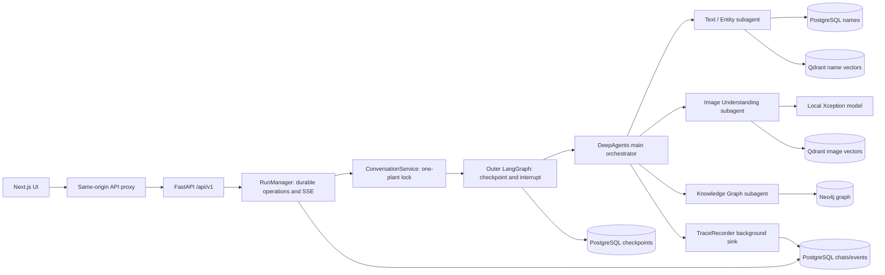
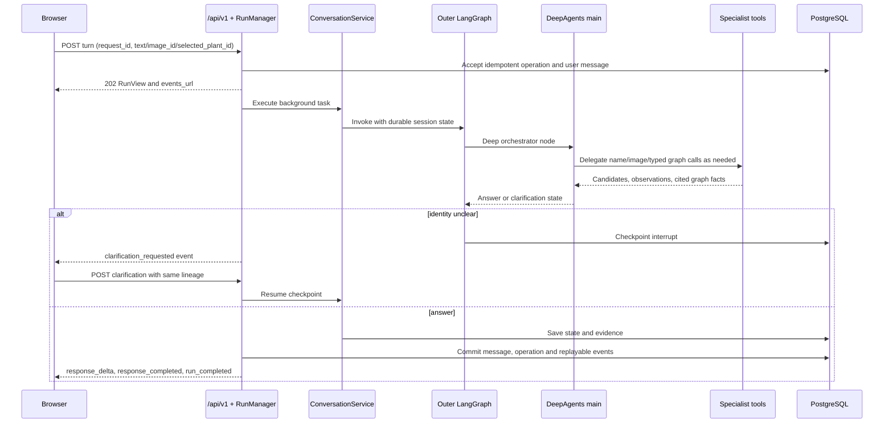
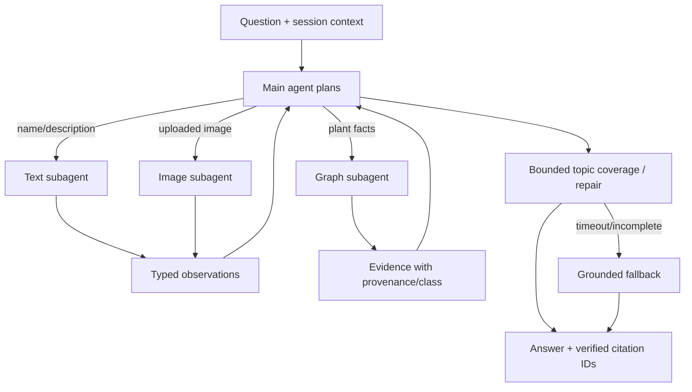

# Implemented architecture

This page describes the runtime assembled by [`backend/main.py`](../../backend/main.py). The main DeepAgents agent is the orchestrator; `text_entity`, `image_understanding`, and `knowledge_graph` are its three specialist subagents. `AgentHost` is dependency/trace plumbing, not a fourth specialist or an independent action selector. Some older state/contracts retain names from the removed harness; see [limitations](../testing-and-limitations/README.md).

## Startup and dependency ownership

`create_app()` creates typed settings, the three capability objects, `AgentHost`, `ConversationService`, trace recorder, routes, and middleware. Lifespan opens one Neo4j driver when enabled. With `TEXT_SEARCH_ENABLED`, it opens a PostgreSQL pool, obtains an advisory single-process lease, checks that schema/search data already exist, opens the PostgreSQL LangGraph checkpointer, creates the hybrid name search, and optionally validates Qdrant semantic search. With `IMAGE_ENABLED`, it loads the configured Xception artifacts off the event loop and opens image-vector retrieval. It installs the real specialist providers, switches sessions/traces from in-memory adapters to PostgreSQL, creates `RunManager`, then compiles the outer LangGraph with either PostgreSQL checkpoints or an in-memory saver. Shutdown closes runs, trace writer, checkpointer, vectors, PostgreSQL, and Neo4j. This lifespan does **not** run migrations, seed Neo4j, or build vector indexes.

`AgentModelFactory` lazily creates/caches one `BaseChatModel` per role. Main, text, image, and graph can have separate configured provider/model values; unspecified specialist settings inherit main settings. Ollama uses `ChatOllama`; other providers use LangChain `init_chat_model` and require the matching installed integration and credentials. The active answer is produced by the DeepAgents main model. `GroundedResponseProvider` is a fallback for failed/incomplete generation, not a separate always-on final LLM pipeline.

## One turn, from submission to answer

The service validates a selected plant ID against the search catalog. When one plant is established, it persists `active_plant`, `locked_plant_id`, and `mode=conversation`. A different selected plant is rejected with `PLANT_SCOPE_LOCKED`; the runtime also checks the lock before finalizing. For a direct candidate confirmation, the runtime can return the identification message without waiting for model generation. An uncertain discovery can produce candidates and a `ClarificationRequest`; `langgraph.types.interrupt` resumes the same checkpoint and task lineage.

The main agent receives a bounded prompt built from the current question, locked plant, up to three recent dialogue turns, and cited facts/named entities from the **immediately preceding** answer. `effective_question` resolves short retries/acknowledgments against that turn. Previous assistant prose supplies conversational context, not verified evidence. The model decides when to delegate, subject to registered specialist tools. The graph tool accepts `QueryType` plus typed optional filters, forces the active plant, caches repeated calls within a turn, and caps graph calls at three. Cross-plant query types are refused in a one-plant chat. A post-generation coverage check interprets the effective question and performs bounded typed retrieval for missed topics. The main model may then revise from the newly retrieved facts. Response checks clean simple math syntax, reject unfinished plans and certain misleading scientific phrasing, remove unknown citation IDs, and map surviving IDs to numbered markers. These are bounded heuristics, **not** complete scientific validation.

## Data and evidence boundaries

Neo4j is the curated graph. The graph capability uses code-owned, parameterized, plant-scoped read queries; neither user text nor model output becomes arbitrary Cypher. PostgreSQL is the durable application source for sessions, turns, messages, run status/events, uploaded images, search projection, reference notes, traces, and checkpoints. Qdrant holds **separate** plant-name and image-reference collections. Name autocomplete calls the search service directly through the API and is independent of the DeepAgents response mode. The image path combines the supplied local Xception leaf classifier and optional image-vector neighbors; its result is a candidate suggestion, not proof of identity.

Evidence has modality (`text`, `image`, `graph`), class, confidence, provenance, source URLs, and optional graph path. The answer may add general pretrained scientific explanation, but plant-specific assertions and citations should be anchored to retrieved facts. Document/source links are attached to evidence; the frontend should open the link associated with the clicked citation rather than an unrelated search result. `TraceRecorder` queues domain events to a background sink; normal control flow does not await trace persistence. OpenTelemetry instrumentation is separate from the public SSE event log.

The graph tool's one-plant query surface includes `GET_PLANT_DETAILS`, `GET_PLANT_ALIASES`, `GET_PLANT_PARTS`, `GET_PLANT_PART_DETAILS`, `GET_PHYTOCHEMICALS`, `GET_PHYTOCHEMICAL_DETAILS`, `GET_BIOACTIVITY`, `GET_PROTEIN_TARGETS`, `GET_THERAPEUTIC_USES`, `GET_DOCUMENTS`, and `GET_EVIDENCE`. The `QueryType` contract also defines reverse/cross-plant types, but the active runtime refuses `COMPARE_PLANTS`, `TRACE_EVIDENCE`, `GET_PLANTS_CONTAINING_COMPOUND`, `GET_PLANTS_FOR_THERAPEUTIC_USE`, and `GET_COMPOUNDS_TARGETING_PROTEIN` in a locked one-plant conversation. Detail queries require their specific filter ID. The underlying graph retrieval may return a gap or truncated result; neither implies the concept is absent from science generally.

The explicit PostgreSQL migrations define these groups:

| Migration | Tables and indexes | Why they exist |
| --- | --- | --- |
| `001_search.sql` | `search_generation`, `search_plant`, `search_name` with exact/prefix/FTS/trigram indexes; `app_session`, `app_turn`, `domain_trace`, `text_evaluation` | Name projection, durable state, domain events and evaluations. |
| `002_entity_catalog.sql` | `search_entity` with exact/trigram indexes | Searchable non-plant entity labels. |
| `003_chat_api.sql` | Session title/archive/list index; `api_operation`, `chat_message`, `api_event`, `chat_image` | Idempotent async chat, transcript, SSE replay and uploaded bytes. |
| `004_reference_notes.sql` | `reference_note` | Optional verified external term definitions. |

`backend/database/postgres/checkpoints.py` provisions the LangGraph checkpoint schema in the explicit `search_admin migrate` operation. Application startup checks for required tables/generation and fails early if preparation was omitted. Qdrant and PostgreSQL search records share a generation; restore matched snapshots or rerun explicit `sync`.

## Operational limits visible in code

The server holds a PostgreSQL advisory process lease and explicitly rejects a second backend process for this demo database. `RunManager` bounds concurrent runs with `MAX_ACTIVE_RUNS`, maintains a per-session lock, and persists replayable SSE events. On startup it marks stale operations interrupted; an interrupted run can be explicitly resumed. Model latency, graph calls, local GPU/RAM, database pools, and SSE polling make this a bounded single-process MVP rather than a documented multi-worker deployment. Redis has an adapter and optional Compose service, but the active startup path does not instantiate it. See [testing and limitations](../testing-and-limitations/README.md) for what has not been verified.
