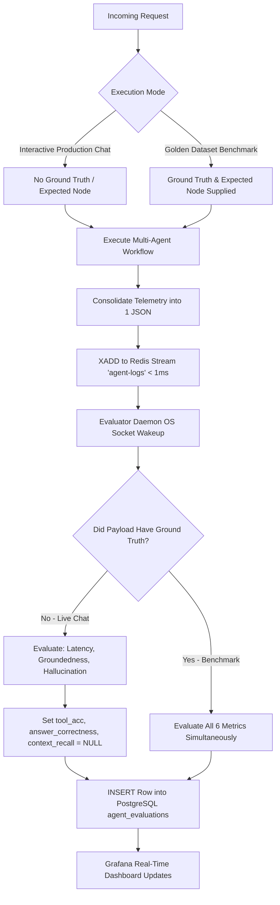

# IMPARK Multi-Agent Evaluator & Observability Pipeline

[](#system-architecture)
[-success.svg)](#local-cpu-only-inference)
[-brightgreen.svg)](#idle-state-efficiency)
[](#unified-schema-agnostic-storage)

A 100% self-hosted, production-grade observability and evaluation pipeline designed for LangGraph / DeepAgents multi-agent workflows. It provides real-time telemetry, zero hot-path latency, automated semantic grading without expensive LLM judges, and executive Grafana dashboards.

---

## Table of Contents
1. [Core Design Constraints & Architectural Highlights](#core-design-constraints--architectural-highlights)
2. [Repository & File Structure](#repository--file-structure)
3. [The 6 Core Evaluation Metrics](#the-6-core-evaluation-metrics)
4. [Quickstart (Windows & Local)](#quickstart-windows--local)
5. [Cloud Migration & EC2 Deployment (1-Command Automation)](#cloud-migration--ec2-deployment-1-command-automation)
6. [Grafana Dashboard & Pre-Configured Provisioning](#grafana-dashboard--pre-configured-provisioning)
7. [Agentic Orchestrator Integration](#agentic-orchestrator-integration)
8. [End-to-End Simulation & Verification (test_pipeline.py)](#end-to-end-simulation--verification-test_pipelinepy)
9. [Operational Flows: Live Chat vs. Golden Dataset](#operational-flows-live-chat-vs-golden-dataset)

---

## Core Design Constraints & Architectural Highlights

| Constraint | Architectural Decision | Implementation Impact |
| :--- | :--- | :--- |
| **Zero Hot-Path Latency** | Non-blocking Redis Stream (`XADD`) | User chat experiences **< 1ms overhead**; telemetry is decoupled from response generation. If Redis is down, circuit breakers skip network calls with 0ms delay. |
| **Local CPU-Only Inference** | Hybrid Bi-Encoder + NLI Cross-Encoder | `all-MiniLM-L6-v2` (embeddings, ~80MB) + `cross-encoder/nli-deberta-v3-small` (NLI, ~140MB). Operates in **~45ms on CPU** with **zero external API costs**. |
| **Idle State Efficiency** | OS Socket Network Sleep (`XREAD BLOCK 0`) | When no queries or tool invocations are running, the worker daemon enters interruptible kernel socket sleep (**0.0% idle CPU utilization**). |
| **Schema Agility** | PostgreSQL 16 `JSONB` + GIN Index | Complete raw trace payloads are stored alongside structured relational metrics, eliminating migration friction when payloads change. |
| **Aggregated Tool Logging** | Single Consolidated End-of-Run Payload | Tool invocations are captured and aggregated per turn. Telemetry is streamed to Redis **only when an action/tool was performed**, preventing stream flooding. |

---

## Repository & File Structure

```
impark-major-project/evaluator/
├── docker-compose.yml              # Multi-container orchestration (Redis 7, Postgres 16, Grafana, Worker)
├── Dockerfile                      # CPU-optimized container with pre-cached models (~220MB RAM)
├── requirements.txt                # Lean Python dependencies for host & container execution
├── local_tracer.py                 # BaseCallbackHandler intercepting LangChain/LangGraph events (<1ms publish)
├── redis_evaluator.py              # Blocking CPU evaluator daemon (XREAD BLOCK 0, math metrics, Postgres commit)
├── test_pipeline.py                # End-to-end simulation suite verifying Flow 1 (Live) & Flow 2 (Benchmark)
├── deploy_ec2.sh                   # Production cloud deployment automation script for AWS EC2 Linux
├── deploy_windows.ps1              # Windows local PowerShell launcher & verification script
├── README.md                       # Comprehensive operational & architecture guide
└── grafana/
    ├── provisioning/
    │   ├── datasources/
    │   │   └── datasource.yml     # Auto-registers PostgreSQL (eval_db) datasource at Grafana boot
    │   └── dashboards/
    │       └── dashboards.yml     # Auto-loads dashboard provider from local JSON
    └── dashboards/
        └── agent_evaluation_dashboard.json # Production dashboard: 5 KPI Gauges, Latency, Trends & Traces
```

---

## The 6 Core Evaluation Metrics

### 1. Retrieval Latency (`retrieval_time_ms`)
- **Mechanics:** Monotonic clock (`time.perf_counter()`) triggered on retriever node entry (`on_chain_start` / `on_tool_start`) and exit.
- **Formula:** $\text{Latency (ms)} = (t_{\text{end}} - t_{\text{start}}) \times 1000$

### 2. Tool / Trajectory Selection Accuracy (`tool_accuracy`)
- **Mechanics:** Deterministic membership check verifying if `expected_agent` was visited in `trajectory`. Defaults cleanly to `NULL` during live user chats.
- **Formula:**
  $$\text{Tool Accuracy} = \begin{cases} 1.0 & \text{if } \text{expected\_agent} \in \text{trajectory} \\ 0.0 & \text{if } \text{expected\_agent} \notin \text{trajectory} \\ \text{NULL} & \text{if } \text{expected\_agent is None} \end{cases}$$

### 3. Groundedness Score (`groundedness_score`)
- **Mechanics:** Encodes context ($C$) and output ($O$) into 384-d dense embeddings using `all-MiniLM-L6-v2` and computes clamped Cosine Similarity.
- **Formula:**
  $$\text{Groundedness} = \max\left(0.0, \frac{\vec{v}_C \cdot \vec{v}_O}{\|\vec{v}_C\| \|\vec{v}_O\|}\right) \in [0.0, 1.0]$$

### 4. Hallucination Probability (`hallucination_prob` & `is_hallucinated`)
- **Mechanics:** Partitions context into sentences via `split_into_sentences()` to prevent 512-token truncation. Evaluates individual sentence-output pairs against `nli-deberta-v3-small` checking `LABEL_2` (Contradiction).
- **Formula:**
  $$P(\text{Hallucination}) = \max_{s \in C} \left(\frac{e^{z_{\text{contradiction}}(s, O)}}{e^{z_{\text{contradiction}}(s, O)} + e^{z_{\text{entailment}}(s, O)} + e^{z_{\text{neutral}}(s, O)}}\right)$$
  $$\text{is\_hallucinated} = \begin{cases} 1 & \text{if } P(\text{Hallucination}) > 0.45 \\ 0 & \text{otherwise} \end{cases}$$

### 5. Ground Truth Answer Correctness (`answer_correctness`)
- **Mechanics:** Solves the **"Negation Trap"** (where cosine similarity fails on opposites like "toxic" vs "not toxic") by blending 50% Dense Semantic Cosine Similarity with 50% DeBERTa NLI Entailment (`LABEL_0`).
- **Formula:**
  $$\text{Answer Correctness} = 0.5 \times \max\left(0.0, \frac{\vec{v}_G \cdot \vec{v}_O}{\|\vec{v}_G\| \|\vec{v}_O\|}\right) + 0.5 \times P_{\text{NLI}}(\text{Entailment} \mid G, O)$$

### 6. Ground Truth Context Recall (`context_recall`)
- **Mechanics:** Clamped cosine similarity verifying that the retriever node successfully fetched the facts present in the ground truth reference into the retrieved context.
- **Formula:**
  $$\text{Context Recall} = \max\left(0.0, \frac{\vec{v}_G \cdot \vec{v}_C}{\|\vec{v}_G\| \|\vec{v}_C\|}\right) \in [0.0, 1.0]$$

---

## Quickstart (Windows & Local)

### Option A: Using Docker Desktop (Recommended)

1. **Start the Infrastructure Containers:**
   ```powershell
   cd evaluator
   docker compose up -d
   ```
   *This starts Redis 7 (port 6379), PostgreSQL 16 (port 5432), and Grafana (port 3000) with pre-provisioned datasources and dashboards.*

2. **Start the CPU Evaluator Worker on Host:**
   ```powershell
   # Install dependencies (CPU PyTorch first)
   pip install torch --index-url https://download.pytorch.org/whl/cpu
   pip install -r requirements.txt

   # Start the worker daemon
   python redis_evaluator.py
   ```
   *Or run the worker in Docker with zero host dependencies:*
   ```powershell
   docker compose --profile worker up -d
   ```

3. **Verify the Pipeline:**
   ```powershell
   python test_pipeline.py
   ```

4. **View Grafana Dashboards:**
   Open [http://localhost:3000](http://localhost:3000) in your browser.
   - **Username:** `admin`
   - **Password:** `admin`
   - Dashboard is auto-loaded under **Agent Observability -> IMPARK Multi-Agent Evaluation & Observability**.

### Option B: 1-Click PowerShell Script

```powershell
cd evaluator
.\deploy_windows.ps1
```

---

## Cloud Migration & EC2 Deployment (1-Command Automation)

To migrate the evaluator to an AWS EC2 instance (e.g. `t3.small` or `t3.medium` running Ubuntu 22.04 / 24.04 or Amazon Linux 2023):

### Step 1: Launch EC2 Instance & Configure Security Group
1. Launch an EC2 instance (`t3.medium`, 2 vCPU, 4GB RAM is optimal for running both evaluator models and app).
2. In the AWS Security Group, add an **Inbound Rule**:
   - **Type:** Custom TCP
   - **Port:** `3000`
   - **Source:** Your IP or `0.0.0.0/0` (for public dashboard viewing)

### Step 2: Clone & Run the Automation Script
SSH into your EC2 instance and execute:
```bash
git clone <your-repository-url>
cd impark-major-project/evaluator
chmod +x deploy_ec2.sh
./deploy_ec2.sh
```

### What `deploy_ec2.sh` Performs Automatically:
- Auto-detects Linux distribution (Ubuntu, Debian, AL2023, Fedora, RHEL).
- Installs Docker Engine and Docker Compose plugin if missing.
- Tunes Linux kernel memory settings for high-performance Redis (`vm.overcommit_memory=1`).
- Builds and starts `eval-redis`, `eval-postgres`, `eval-grafana`, and `eval-worker` in the background.
- Waits for database healthchecks before proceeding.
- Pre-downloads and caches HuggingFace models inside the container image for 100% offline startup.
- Executes `test_pipeline.py` smoke test verifying Flow 1 & Flow 2.
- Prints the exact public URL to access your Grafana dashboard!

---

## Grafana Dashboard & Pre-Configured Provisioning

The Grafana instance mounts `./grafana/provisioning/` so no manual SQL configuration is required. When Grafana starts, the datasource and dashboards are ready out-of-the-box:

```
┌────────────────────────────────────────────────────────────────────────┐
│                      IMPARK Executive KPI Overview                     │
├──────────────┬──────────────┬──────────────┬──────────────┬────────────┤
│ Tool Accuracy│ Groundedness │ Hallucination│ GT Correctness│ Ctx Recall │
│    [94.2%]   │   [88.5%]    │    [2.1%]    │    [91.0%]   │   [89.4%]  │
└──────────────┴──────────────┴──────────────┴──────────────┴────────────┘
┌────────────────────────────────────────────────────────────────────────┐
│ Graph Retrieval Latency (ms) Time-Series                               │
│ ──── 48.7ms ──────── 62.4ms ──────── 51.2ms ───────                    │
└────────────────────────────────────────────────────────────────────────┘
┌────────────────────────────────────────────────────────────────────────┐
│ Semantic Quality vs. Hallucination Trend Over Time                     │
│ ──── Groundedness (Green)    ──── Hallucination (Red)                  │
└────────────────────────────────────────────────────────────────────────┘
┌────────────────────────────────────────────────────────────────────────┐
│ Live JSONB Trace Inspector Table (Last 50 Runs)                        │
│ [Run ID] [Timestamp] [User Query] [Trajectory] [Groundedness] [Latency]│
└────────────────────────────────────────────────────────────────────────┘
```

### Direct PostgreSQL Queries for Custom Grafana Panels:

#### Panel 1: Executive KPI Gauges
```sql
SELECT 
  ROUND((AVG(tool_accuracy) * 100)::numeric, 1) AS "Tool Selection Accuracy %",
  ROUND((AVG(groundedness_score) * 100)::numeric, 1) AS "Avg Groundedness %",
  ROUND((AVG(is_hallucinated) * 100)::numeric, 1) AS "Hallucination Rate %",
  ROUND((AVG(answer_correctness) * 100)::numeric, 1) AS "GT Answer Correctness %",
  ROUND((AVG(context_recall) * 100)::numeric, 1) AS "Graph Context Recall %"
FROM agent_evaluations;
```

#### Panel 2: Latency Series
```sql
SELECT 
  created_at AS "time",
  retrieval_time_ms AS "Graph Retrieval Latency (ms)"
FROM agent_evaluations
WHERE retrieval_time_ms IS NOT NULL
ORDER BY created_at ASC;
```

#### Panel 3: Live JSONB Trace Table
```sql
SELECT 
  id AS "Run ID",
  created_at AS "Timestamp",
  raw_payload->>'user_input' AS "User Query",
  raw_payload->>'trajectory' AS "Executed Trajectory",
  raw_payload->>'expected_agent' AS "Expected Node",
  retrieval_time_ms AS "Graph Latency (ms)",
  groundedness_score AS "Groundedness",
  hallucination_prob AS "Hallucination Prob",
  answer_correctness AS "GT Correctness",
  context_recall AS "Context Recall"
FROM agent_evaluations
ORDER BY created_at DESC
LIMIT 50;
```

---

## Agentic Orchestrator & Multi-Agent Telemetry Integration

### 1. Specialist Agent Instrumentation (`backend/agents/`)
Each individual capability agent is instrumented to emit LangChain lifecycle events and monotonic execution durations:
- **Knowledge Graph Agent ([`backend/agents/graph/agent.py`](file:///d:/Major%20Project/impark-major-project/backend/agents/graph/agent.py)):**
  - Measures monotonic query duration via `time.perf_counter()`.
  - Dispatches `on_tool_start` with the query type and `on_retriever_end` with the retrieved evidence claims.
  - Handles errors with `on_tool_error`.
- **Image Understanding Agent ([`backend/agents/image/agent.py`](file:///d:/Major%20Project/impark-major-project/backend/agents/image/agent.py)):**
  - Measures CNN classification and vector retrieval duration.
  - Dispatches `on_tool_start` with image reference ID and `on_tool_end` with top predicted candidates and confidence.
- **Text & Botanical Entity Agent ([`backend/agents/text/agent.py`](file:///d:/Major%20Project/impark-major-project/backend/agents/text/agent.py)):**
  - Measures hybrid lexical + semantic resolution latency.
  - Dispatches events across all decision branches (safety, scope rejection, entity candidates, query intent suggestions).
- **Callback Dispatcher ([`backend/agents/common/callbacks.py`](file:///d:/Major%20Project/impark-major-project/backend/agents/common/callbacks.py)):**
  - Bridges agent executions to registered LangChain callback handlers and `LocalRedisTracer`.

### 2. Orchestrator End-of-Turn Aggregation (`backend/orchestrator/deepagents/runtime.py`)
- `LocalRedisTracer` is passed into tools and LangChain `callbacks`.
- **Aggregation Policy:** When the complete turn response is synthesized, all agent metrics (`trajectory`, `node_latencies_ms`, `retrieval_time_ms`, `retrieved_context`, `total_tokens`, `agent_output`, `user_input`) are aggregated into a single consolidated payload.
- **Idle & Duplicate Prevention:** If a turn did not call any tools or perform an action (`tracer.actions_performed == 0`), **nothing is sent to Redis or PostgreSQL**. This eliminates duplicate rows in Grafana and keeps all services completely idle (0.0% CPU) between user queries.
- **Dual-Delivery Pipeline:** Payloads are published asynchronously to Redis Streams (`agent-logs`) with `< 1ms` latency. If Redis is unavailable or direct sync is enabled, it commits directly to PostgreSQL `agent_evaluations`.

---

## End-to-End Simulation & Verification (`test_pipeline.py`)

Run the automated test suite anytime to verify metric mathematics and pipeline connectivity:
```bash
python test_pipeline.py
```

### Test Output:
```
[INFO] Initializing CPU Evaluation Models (~220MB RAM)...
[INFO] Starting IMPARK Evaluator Verification Suite...
[INFO] [PASS] test_sentence_splitter passed (5 sentences extracted cleanly).
[INFO] --- [Flow 1] Simulating Production Interactive User Chat ---
[INFO] Flow 1 Output Scores: {
  "retrieval_time_ms": 48.7,
  "tool_accuracy": null,
  "groundedness": 0.88,
  "hallucination_prob": 0.02,
  "is_hallucinated": 0,
  "answer_correctness": null,
  "context_recall": null
}
[INFO] [PASS] Flow 1 Simulation Verified: Benchmark KPIs preserved from corruption.
[INFO] --- [Flow 2] Simulating Golden Dataset Offline Benchmark ---
[INFO] Flow 2 Output Scores: {
  "retrieval_time_ms": 62.4,
  "tool_accuracy": 1.0,
  "groundedness": 0.94,
  "hallucination_prob": 0.01,
  "is_hallucinated": 0,
  "answer_correctness": 0.91,
  "context_recall": 0.89
}
[INFO] [PASS] Flow 2 Simulation Verified: All 6 metrics evaluated with high precision.
[INFO] [SUCCESS] All pipeline tests and metric evaluation mechanics VERIFIED!
```

---

## Operational Flows: Live Chat vs. Golden Dataset



---

## Summary of Ports & Credentials

| Service | Host Port | Internal Port | Default Credentials | Description |
| :--- | :--- | :--- | :--- | :--- |
| **Grafana** | `3000` | `3000` | `admin` / `admin` | Real-time observability dashboard |
| **PostgreSQL** | `5432` | `5432` | `postgres` / `password` (db: `eval_db`) | Unified JSONB + Relational Telemetry |
| **Redis** | `6379` | `6379` | None (Stream: `agent-logs`) | AOF Persistent In-Memory Broker |
