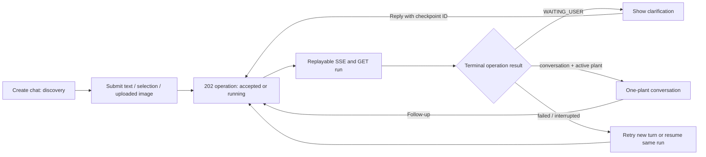

# IMPARK frontend

This directory contains the Next.js App Router frontend and the backend integration contract. The app uses the existing `/api/v1` endpoints through a same-origin Next.js proxy; it does not implement agent decisions in the browser.

For local development in PowerShell, start the backend and its databases using the root [README](../README.md), then run:

```powershell
cd frontend
npm install
Copy-Item .env.example .env.local
npm run dev
```

Open `http://127.0.0.1:3000`. Set `BACKEND_URL` in `frontend/.env.local` if the backend is elsewhere. If the backend requires an API key, set `BACKEND_API_KEY` in that server-only file. The browser-side Connection dialog is an optional tab-scoped development fallback; the key is held in memory and never placed in a public build variable. Run `npm test`, `npm run typecheck`, and `npm run build` to verify the frontend. The same frontend build serves `/` and `/chat/{session_id}`; reloads restore persisted chats and active operations.

## Backend integration specification

This guide describes the **implemented** `/api/v1` backend for the single-user academic demonstration. Treat [OpenAPI](contracts/openapi.json) and the [SSE event schema](contracts/stream-event.schema.json) as machine-readable contracts. The framework-independent [fetch client](api/client.mjs) and [client tests](api/client.test.mjs) are starting points. `/dev/*` is a separate synchronous development surface; do not build the frontend on it.

The frontend uses Next.js and npm. The current backend supports one shared demo workspace, not user accounts or private per-user histories. For a hosted demo, keep `API_KEY` in the Next.js server environment; never embed the shared key in public JavaScript. Start the backend with `python -m backend`; `/docs` and `/health` are served at `http://127.0.0.1:8000` by default.

## Product and state model

Every chat starts in `discovery`: the user can type a plant name, description or question, upload an image, combine text and image, or choose an autocomplete result. The backend may request clarification. Once a plant is established the chat enters `conversation`, and that plant is locked for the chat's lifetime. Another plant or a cross-plant comparison requires **New chat**. Always show `state.session_notice` and, once present, `state.active_plant`. Do not replace the active plant client-side.

Image predictions are suggestions requiring user confirmation. The currently configured classifier covers 40 leaf classes; it does not establish plant part or arbitrary non-plant identity. Check `GET /api/v1/capabilities` before showing image-identification UI. The frontend submits user intent; the backend harness selects actions, checks evidence and authorizes generation. Never implement agent routing, confidence-based automatic selection, synthetic citations or medical claims in the UI.

There are **two status layers**:

| Layer | Field | Values and use |
| --- | --- | --- |
| Durable operation | `RunView.status` | `accepted`, `running`, `interrupted`, `complete`, `cancelled`, `failed`. Controls transport, reconnect, cancel and resume. |
| Domain turn | `RunView.result.status` or `SessionSummary.state.status` | `READY`, `RUNNING`, `COMPLETE`, `ABSTAINED`, `WAITING_USER`, `FAILED`, `MAX_ITERATIONS_REACHED`, `EVIDENCE_UNAVAILABLE`, `SAFETY_ABSTENTION`, `SCOPE_REJECTED`, `CANCELLED`. Controls what the user sees next. |

`RunView.status="complete"` with `result.status="WAITING_USER"` means the operation finished and the backend is waiting for a clarification reply. It is not an answer or transport error. `result.response` and `result.clarification` are nullable. An abstention/limitation response can still be useful; do not hide it solely because the domain status differs from `COMPLETE`.



Recommended client state: `sessionId`, `sessionSummary`, ordered `messages`, `currentOperationId`, `requestId`, `lastSequence`, `draftResponse`, `run`, `pendingClarification`, `upload`, and a separate network state. Preserve an outstanding operation ID, request ID and processed SSE sequence across page refresh. Never store the API key, raw images or sensitive question text in browser local storage.

## Transport, authentication and errors

- `/api/v1` is the application API. Health routes are `/health` and `/health/{postgres,qdrant,neo4j,llm}`. `/dev` is test-only and may be disabled.
- When `API_KEY` is set, send `Authorization: Bearer <key>` on **every** `/api/v1` request, including image fetches and SSE. With no key, `/api/v1` is available only when `APPLICATION_ENV=development` and `ENABLE_DEVELOPMENT_API=true`; do not use this bypass for a hosted demo.
- JSON requests use `Content-Type: application/json`. Image upload uses a **raw binary body** and matching `Content-Type: image/png`, `image/jpeg` or `image/webp`. No multipart form or base64 JSON.
- `X-Correlation-ID` can be supplied as a UUID; the server returns it as a response header and in error bodies. Keep it for support. It is **not** the idempotency key.
- IDs are strings in JSON, timestamps are ISO-8601, unknown request fields are rejected. Submitted text is trimmed and is limited to 8,000 characters. A blank request must include an image or selection.
- Chat title length is 1–120 characters. `POST /conversations` needs a JSON object body even when using the default title. On update, omit fields you do not want to change; `null` leaves the current title/archive state intact.
- CORS permits `GET`, `POST`, `PATCH`, `DELETE`, `OPTIONS` and headers `Content-Type`, `X-Correlation-ID`, `Authorization`, `Last-Event-ID`. Configure the exact frontend origin in backend `CORS_ORIGINS`.
- `GET /api/v1/capabilities` is the feature-flag source: check `image_classifier`, `image_scope`, `max_image_bytes`, `streaming`, `one_plant_per_session` and `response_policy`. `image_classifier=false` means image upload exists but classification is unavailable; explain that before inviting image-only discovery.

Handled errors use `{ "code": "CONFLICT", "message": "Conversation has an active or interrupted run", "correlation_id": "<uuid>" }`. Use `code` for client decisions, retain the correlation ID, and show only safe server messages. Do not parse message prose as a machine signal. Server validation intentionally does not echo submitted text. An operation accepted earlier may fail asynchronously: check `RunView.status` and `error_code`, not just the POST status.

## Endpoint reference

All path IDs are UUIDs. Pagination uses `limit` 1–100 and `offset` 0–100000; follow returned `next_offset` until null. Chat lists are ordered by latest update descending; messages are ordered ascending by creation and role.

| Method | Path | Input | Success | Purpose |
| --- | --- | --- | --- | --- |
| GET | `/api/v1/capabilities` | — | capability object | Read deployment features/limits. |
| POST | `/api/v1/conversations` | `{ "title": "New chat" }` | `201 SessionSummary` | Create discovery chat. |
| GET | `/api/v1/conversations?archived=false&limit=100&offset=0` | query | `200 SessionPage` | Sidebar follows every page so older chats are visible before deletion; archived defaults false. |
| GET | `/api/v1/conversations/{sid}` | — | `200 SessionSummary` | Restore mode, plant and clarification. |
| PATCH | `/api/v1/conversations/{sid}` | `{ "title"?: string, "archived"?: boolean }` | `200 SessionSummary` | Rename/archive/restore. |
| DELETE | `/api/v1/conversations/{sid}` | — | `204` | Delete chat; cancel active/interrupted run first. |
| GET | `/api/v1/conversations/{sid}/messages?limit=50&offset=0` | query | `200 MessagePage` | Durable ordered history. |
| POST | `/api/v1/conversations/{sid}/turns` | `TurnCreate` | `202 RunView` | Start text, selection, image or combined turn. |
| POST | `/api/v1/conversations/{sid}/clarifications` | `ClarificationCreate` | `202 RunView` | Reply to pending clarification. |
| GET | `/api/v1/discovery/autocomplete?q=neem` | nonblank `q`, 1–200 chars | `200 AutocompleteResponse` | Suggestions, no identity commitment. |
| POST | `/api/v1/conversations/{sid}/images` | raw PNG/JPEG/WebP | `201 ImageReference` | Upload before using `image_id`. |
| GET | `/api/v1/conversations/{sid}/images` | — | `200 ImageReference[]` | List chat uploads. |
| GET | `/api/v1/conversations/{sid}/images/{iid}` | — | `200 image bytes` | Authenticated preview. |
| DELETE | `/api/v1/conversations/{sid}/images/{iid}` | — | `204` | Remove upload; blocked during active/interrupted run. |
| GET | `/api/v1/runs/{oid}` | — | `200 RunView` | Authoritative operation state. |
| GET | `/api/v1/runs/{oid}/events?after=N` | `after>=0`; optional `Last-Event-ID` | `200 text/event-stream` | Replay and live updates. |
| POST | `/api/v1/runs/{oid}/cancel` | — | `200 RunView` | Cancel an operation. |
| POST | `/api/v1/runs/{oid}/resume` | — | `202 RunView` | Resume **only** an interrupted run. |
| GET | `/api/v1/runs/{oid}/evidence` | — | `200 EvidencePage` | Resolve final citation IDs. |

`/dev` has a trace endpoint, but `/api/v1/capabilities` reports `public_trace: false`. Do not expose the development trace route in the frontend.

## JSON shapes the UI must understand

`SessionSummary` contains `session_id`, `title`, `archived`, `created_at`, `updated_at`, `state: ChatResponse`. `SessionPage` and `MessagePage` contain `items` and nullable `next_offset`. `MessageView` contains `message_id`, `operation_id`, `role` (`user` or `assistant`), `content`, `status`, `data`, `created_at`. An assistant row may be `pending`/`streaming` before becoming `complete`, `failed`, `cancelled` or `interrupted`. Its `data` contains result/evidence after finalization; user-row `data` contains submitted request metadata. Do not assume every `data` key exists, and do not expose internal data as raw JSON.

`RunView` contains `operation_id`, `session_id`, operation `status`, nullable `result: ChatResponse`, nullable `error_code`, and relative `events_url`. Resolve `events_url` against the same API origin and authenticate it. `ChatResponse` contains `correlation`, `mode`, domain `status`, nullable `active_plant`, `clarification`, `response`, `understanding`, `image_understanding`, and `session_notice`. Its `correlation.run_id` is the domain lineage ID; the API `operation_id` is the frontend handle. Clarification replies use a new operation while preserving domain lineage, so never equate the two IDs.

`CandidatePlant` has string `plant_id`, display `label`, `confidence` (0–1), `provenance[]`, and optional `match_method`, `matched_name`, `language`, `alias_type`. Send `plant_id`, not a label, when choosing a candidate. The initial `/turns` contract requires this selected ID to parse as a UUID; the clarification contract accepts a string ID and checks it against offered candidates. `AutocompleteResponse` contains `implemented`, `detail`, `candidates[]`. If `implemented=false`, keep ordinary text entry available.

`ClarificationRequest` contains `clarification_id`, `question`, `candidates[]`. Candidates may be empty; allow free text and, when relevant, a replacement image. `ClarificationCreate` requires a **new** `request_id` and the pending `clarification_id`; it has nonempty `text` (default `"Selected candidate"`), optional string `selected_plant_id`, optional UUID `image_id`. A selected ID must occur among **that clarification's** candidates. An autocomplete candidate is not automatically valid here. Do not send selection and replacement image together. A stale clarification ID returns `409`.

`FinalResponse` has `text`, `citation_ids[]`, `placeholder`, `provider`, optional `model`, `fallback_used`. `fallback_used=true` means server-side response formatting fell back to verified rendering; show its final text. The Final LLM's raw tokens and prompts are not a UI contract. `EvidencePage.items[]` have `evidence_id`, `modality` (`text`, `image`, `graph`), `claim`, `evidence_type` (`traditional`, `preclinical`, `in-vitro`, `animal`, `clinical`, `mechanistic`, `established`, `unknown`), confidence, source quality, provenance and optional graph data/URLs. Join `citation_ids` to `evidence_id`; show an unavailable-source label if an item is missing. Never invent a citation or promote an evidence class into clinical proof.

## Discovery flow

1. `POST /api/v1/conversations`, then show its `state.session_notice`. Restore a known chat with `GET /conversations/{sid}` and `/messages`; do not infer mode from message count.
2. For a typed name, description or question, submit `/turns`. Generate a UUID `request_id` before POST and retain it for retries of the *identical* input. Do not force a client-side intent selector.
3. For autocomplete, debounce nonblank input (UI suggestion: 250–350 ms), cancel stale requests and display results only for the current query. Show matched alias/language where provided. Choosing a suggestion does not activate it: submit its `selected_plant_id`. For name-only search, omit `text` after choosing a candidate; the backend adds the verified canonical name itself, and sending the typed alias as well can create an ambiguous two-name input. Preserve `text` only when it contains an actual question or description. The backend verifies the ID and runs the Text Agent. If `implemented=false` or search is unavailable, keep free text working.
4. For an image, check file type/bytes client-side against capabilities, upload **raw bytes**, then submit the returned `image_id` with optional `text`. Do not send the image contents in a turn. Image understanding/candidates are suggestions; let the backend request confirmation.
5. If the operation finishes with `result.mode="discovery"`, `result.status="WAITING_USER"` and `result.clarification`, render its question and offered candidates. Preserve the initial user question. Reply through `/clarifications` using the pending `clarification_id` plus selected candidate, free text or a new uploaded image. Do not start a parallel run. Although `/turns` during `WAITING_USER` is interpreted as a reply by this backend, use the explicit clarification route.
6. When the result becomes `mode="conversation"` with an `active_plant`, pin it in the chat header. The initial discovery question may already have a response in that same result; render it. Otherwise allow a follow-up.

If an older run in a locked chat is already waiting on a plant-name clarification, the conversation UI offers **Continue with the active plant**. It resubmits the original question through the same clarification checkpoint, preserving the chat and its one-plant lock. Never offer a different candidate from that stale clarification as a way to change the active plant.

Example turn body (the UUID and plant ID are placeholders, not fixtures):

```json
{"request_id":"<uuid>","text":"Which compounds are reported in neem leaves?"}
```

Autocomplete selection with retained question:

```json
{"request_id":"<new-uuid>","text":"What are its documented uses?","selected_plant_id":"<plant_id-from-autocomplete>"}
```

Clarification reply to `/clarifications`:

```json
{"request_id":"<new-uuid>","clarification_id":"<pending-id>","text":"Selected candidate","selected_plant_id":"<plant_id-from-clarification>"}
```

Upload with `fetch(url, {method: "POST", headers: {"Content-Type": file.type, "Authorization": ...}, body: file})`, then submit `{ "request_id": "<uuid>", "image_id": "<returned-id>", "text": "What plant is this?" }`. PNG, JPEG and WebP only. The default maximum is 5 MiB, 16 million pixels and 8192 pixels per dimension. The server checks actual format, dimensions and content regardless of client checks. Image IDs belong to one chat.

## Conversation and one-plant lock

Follow-up questions use the same `/turns` endpoint and session ID. The backend reassesses each turn and does not blindly reuse old evidence. A natural-language request about another plant may complete normally at the transport layer with `result.status="SCOPE_REJECTED"`; show its safe response and a New chat action. An explicit different `selected_plant_id` can fail immediately with `409 PLANT_SCOPE_LOCKED`. Neither case should replace the active plant. Do not turn either into an automatic new chat without the user's choice.

Only one operation per chat may be `accepted`, `running` or `interrupted`. Disable that chat's composer while one is outstanding; the backend returns `409 CONFLICT` for competing submits. Other chats may operate concurrently subject to backend capacity. An interrupted operation must be resumed or cancelled before another turn. Archived chats reject turns with `409 ARCHIVED`; restore with `PATCH {"archived":false}`.

## Streaming and event reducer

The turn POST returns `202 RunView`, often initially `accepted`. Connect immediately to its `events_url` with authenticated `fetch`. Browser `EventSource` cannot supply the required bearer header; the provided `ChatApi.events()` is suitable for a framework adapter. It handles UTF-8 boundaries, multiline data, comments, duplicate replay events and sequence gaps. A frame contains `id: <sequence>`, `event: <type>`, `data: <JSON StreamEvent>`. `: heartbeat` is a comment, not content.

Every event envelope has `version:1`, `operation_id`, strictly increasing `sequence`, `type`, `payload`. Match the operation ID. Store the last **successfully processed** sequence. Reconnect with `?after=<lastSequence>` or `Last-Event-ID: <lastSequence>`; if both exist the server uses the greater one. The server replays durable events after the cursor, then follows live events. It closes after terminal status. A malformed/ahead cursor returns `422 INVALID_CURSOR`; a sequence gap means fetch the run and rebuild the provisional UI from event zero rather than appending to an uncertain draft.

Example wire frame (the next frame would use sequence 2):

```text
id: 1
event: run_started
data: {"version":1,"operation_id":"<uuid>","sequence":1,"type":"run_started","payload":{"session_id":"<uuid>","resumed":false}}

```

| Event | Payload and frontend effect |
| --- | --- |
| `run_started` | `{session_id, resumed}`. Show processing; `resumed` is boolean. |
| `progress` | `{stage, mode, run_id}`. Generic progress indicator only; do not drive routing from this. |
| `response_started` | `{run_id}`. Start empty provisional assistant bubble. |
| `response_delta` | At least `{text}`; may include citation IDs/provider/model/fallback. **Append** text, without assuming word boundaries. |
| `response_reset` | `{reason}`. **Clear** provisional text/citations before new deltas. Occurs after generation failure or interrupted-run resume. |
| `response_completed` | `FinalResponse`. Replace draft with final `text` and citation IDs. Run may still need terminal event. |
| `clarification_requested` | `ClarificationRequest`. Prepare clarification UI; reconcile with final result. |
| `run_completed` | Full `ChatResponse`, **not RunView**. Commit mode, active plant, response/clarification; refresh messages/session/evidence. |
| `run_failed` | `{code,message}`. Show safe failure; fetch run for authoritative status. |
| `run_cancelled` | `{reason}`. Stop provisional output; refresh history. |
| `run_interrupted` | `{reason}`. Keep operation ID; offer Resume and Cancel after run fetch. |

Suggested reducer:

```text
POST accepted: remember operation_id, request_id, events_url
response_started: draft = ""
response_delta: draft += payload.text; display draft as provisional
response_reset: draft = ""; provisional citations = []
response_completed: draft = payload.text; provisional citations = payload.citation_ids
run_completed: fetch GET /runs/{id}; render result; refresh session/messages/evidence
run_failed/run_cancelled: refresh run and messages; clear pending UI
run_interrupted: retain operation ID; show Resume/Cancel; refresh run
disconnect before terminal: GET /runs/{id}; reconnect from lastSequence
```

For a simple robust implementation, treat terminal SSE as a notification and use `GET /runs/{oid}` as final truth. The assistant message is persisted incrementally during streaming, so mark it provisional until terminal. Do not duplicate answer text after replay or refresh; key history by `message_id` and `operation_id`. If SSE closes without terminal event because of a network fault, verify the run before declaring completion.

## Retries, restart and abrupt behavior

**POST response lost:** resend the *same URL, body and `request_id`*. The backend returns the same operation even if capacity is now full. Reusing that ID with different input or another session gives `409 IDEMPOTENCY_CONFLICT`. A new UUID is for a distinct intentional submit, not a network retry.

**SSE disconnect / page refresh:** closing the stream does **not** cancel backend work. `GET /runs/{oid}`, reconnect after the last processed sequence and refresh durable messages. If uncertain about local replay state, replay from zero into a fresh reducer. Never concatenate replay deltas onto a previously rendered bubble.

**Backend restart:** accepted/running operations may become `interrupted`. Fetch the run. `POST /runs/{oid}/resume` continues the **same operation**; do not submit a new turn/request ID. Expect `response_reset` and discard old partial text. `409 CONFLICT` means the run is no longer interrupted: fetch again. `429 BUSY` means retry later with bounded backoff. Do not auto-resume forever.

**Cancel:** call `POST /runs/{oid}/cancel` and refresh run/messages. Aborting browser `fetch` only closes the connection. Cancel is safe to repeat on complete/failed/cancelled runs. Do not start another turn until terminal. Do not present partial cancelled output as a verified answer.

**Failed run:** inspect `error_code` and keep the correlation ID. Replaying the same failed `request_id` returns the failed operation; an intentional retry **after terminal** needs a new UUID. Avoid automatic infinite retries, especially for health-related questions. A domain `FAILED` result can still contain a safe fallback response; show the returned final text rather than treating it as transport failure.

**Double-click / two tabs:** disable the current chat's composer while a run is active. On `409 CONFLICT`, fetch the session/current run and reconcile instead of creating another operation. A `429 BUSY` *before acceptance* can be retried with the same request ID. A `503 UNAVAILABLE` requires a service recovery; preserve the draft.

**Clarification reply timeout:** the first operation is `complete` despite domain `WAITING_USER`. Its `clarification_id` is the checkpoint key. The reply is a new operation with a new request ID but the same domain run lineage. If the reply POST times out, retry the same reply ID/body. If changing choice, first fetch the old operation/session to learn whether it was accepted; do not race two replies.

## Error handling map

| HTTP/code | Trigger | Client action |
| --- | --- | --- |
| `400 INVALID_INPUT` or failed run with `INVALID_INPUT` | Unknown selection/image or invalid clarification choice; an accepted image turn can fail asynchronously | Preserve draft; refresh suggestions/uploads and inspect run status. |
| `401 UNAUTHORIZED`, `403 FORBIDDEN` | Wrong/missing key or disabled API | Stop requests; surface configuration problem. |
| `404 NOT_FOUND` | Deleted/mismatched chat, run or image | Remove stale handle and return to list. |
| `409 CONFLICT` | Active run, stale clarification, invalid resume/delete/upload removal | Fetch current run/session before next action. |
| `409 IDEMPOTENCY_CONFLICT` | Reused request UUID with changed body/session | Client bug: restore original request or use new ID for new intent. |
| `409 ARCHIVED` | Turn into archived chat | Offer Restore. |
| `409 PLANT_SCOPE_LOCKED` | Explicit selection of another plant | Explain one-plant rule; offer New chat. |
| `409 UPLOAD_LIMIT` | Too many images in chat | Allow removal when no active/interrupted run. |
| `413 IMAGE_TOO_LARGE` | Upload exceeds bytes limit | Ask for smaller image. |
| `422 INVALID_IMAGE` | Bad, corrupt or MIME-mismatched image | Ask for valid PNG/JPEG/WebP. |
| `422 VALIDATION_ERROR` | Bad UUID, blank input, field/length/query error | Correct request; do not echo submitted text. |
| `422 INVALID_CURSOR` | Bad/ahead SSE cursor | Fetch run and rebuild from valid cursor. |
| `429 BUSY` | Global run capacity | Retry later with same request ID if not accepted. |
| `503 UNAVAILABLE` | Required store/entity search unavailable | Preserve draft; show service status. |
| `500 INTERNAL_ERROR` or failed run | Unexpected server failure | Keep correlation ID; fetch run if acceptance was uncertain. |

`INVALID_INPUT` may have different HTTP status on initial turn versus clarification. Use both status and `code`. Never generate local substitute plant facts, dosage, claims or citations when a dependency fails.

## UI behavior and acceptance tests

**Sidebar:** list recent or archived chats, create, rename, archive/restore, and delete with an explicit destructive UI confirmation. Show the active plant when present and paginate. Archived chats open read-only and offer Restore. There is no server-side title generation or multi-user ownership.

**Discovery composer:** text entry, debounced suggestions, optional image picker/preview and combined submit. Show the one-plant notice before the first send. Keep the user's initial question visible through clarification. Use keyboard-accessible candidate selection.

**Clarification:** display the exact server question and offered candidates with labels/matched names; provide free text and optional replacement image. Use the exact pending ID. Never auto-confirm the top candidate/image score. Empty candidates must not create a dead end.

**Conversation:** pin active plant, keep New chat affordance for another plant, allow follow-up text. `SCOPE_REJECTED` is a domain result. Show the server's response text including uncertainty and educational wording.

**Assistant/history:** streaming is provisional; after terminal, replace from durable result/message. Render server text as plain text or safely escaped Markdown, never trusted HTML. Fetch evidence for citation affordances. Deduplicate by message/operation ID. Restore mode/plant/clarification from `GET /conversations/{sid}`, not message count. For image previews use authenticated fetch + Blob object URL, revoke on unmount; the endpoint sends `Cache-Control: private, no-store`.

Test the following with a fake API/SSE server for deterministic UI tests, then smoke-test against configured local stores. Existing backend tests in `tests/api/test_platform_live.py` cover lifecycle, replay, idempotency, cancellation, uploads, clarification restart and event-writer failure. `frontend/api/client.test.mjs` tests the utility parser/client, **not a complete UI**.

| Scenario | Required assertion |
| --- | --- |
| New chat | Discovery mode, one-plant notice visible, no active plant. |
| Name/description | Stable request ID per submit, `202` run followed to terminal, history shown. |
| Autocomplete | Debounce, stale-result suppression, alias/language display; selection sends ID and preserves initial question; `implemented=false` fallback. |
| Image-only / text+image | Raw MIME-correct upload, returned image ID in turn; result treated as unconfirmed. |
| Invalid/oversized image | `413`/`422` shown; no turn started; draft retained. |
| Ambiguous discovery | Complete operation + `WAITING_USER` opens clarification; reply uses checkpoint ID and new request ID. |
| No offered candidates | Free-text/replacement-image reply remains possible. |
| Initial question with selection | Original question survives selection and can be answered in same turn. |
| One-plant lock | Active plant stays fixed; explicit other ID gets `PLANT_SCOPE_LOCKED`; other-plant prose yields `SCOPE_REJECTED` when detected. |
| Follow-up | Same session ID; active plant persists; new evidence/answer shown. |
| Streaming Unicode/chunks | Draft concatenates exactly to final answer; no word-boundary or HTML assumptions. |
| Response reset | Old draft/citations cleared; final equals durable message. |
| SSE disconnect/replay | Cursor resumes without duplicate text; heartbeat ignored; missing terminal event triggers run fetch. |
| Invalid/gapped cursor | Run refreshed and draft rebuilt from zero. |
| POST timeout | Same body/ID replay one operation; no duplicate messages. |
| Different body/same ID | `IDEMPOTENCY_CONFLICT` surfaced. |
| Double submit/two tabs | 409 reconciled; one active operation per chat. |
| Restart | Interrupted run offers Resume/Cancel; resume keeps operation ID and resets draft. |
| Cancel/failure | Backend cancel used; partial text never shown as verified; intentional failed-run retry uses new ID. |
| Archive/restore/delete | Archived send blocked; restore works; delete removes history and yields 404. |
| Pagination | Stable message keys/order and `next_offset` followed. |
| Citations | IDs resolve to evidence or unavailable-source label; never synthetic. |
| Auth/CORS | Bearer sent for JSON, image and SSE; wrong key and missing origin handled. |
| Degraded capabilities | Classifier/search/LLM unavailable states do not imply successful identification. |

For local end-to-end smoke testing, start the backend with a populated local PostgreSQL name index and Neo4j graph; enable the image model and Qdrant image index if testing image discovery. Create a chat, autocomplete, upload a real leaf image, submit, follow `events_url`, fetch run/messages/evidence, reply to clarification, ask a follow-up, archive/restore and delete. Passing this flow does not establish arbitrary image accuracy, clinical validity, multi-tenant privacy or multi-worker scalability.

Numbered markers such as `[2]` in an answer are buttons. Clicking one opens the exact
stored evidence record at the matching number; the Sources button opens the full list.
The API returns evidence IDs and graph claims for each run. If a cited ID is absent from
the run snapshot, the API searches only earlier evidence in the same chat. The panel
shows any still-missing citations explicitly. An external document link is shown only
when the evidence path actually includes a `REPORTED_IN` Document; plant catalog URLs
are background metadata and must never be presented as direct support for a claim.
When a linked Document has a valid `document_chembl_id` but no URL, the source
panel links to that exact ChEMBL ID record. The panel does not create unrelated
PubMed searches for IMPPAT or ChEMBL records; when no direct document link exists,
it says so. Unknown evidence
class is displayed as a recorded source rather than implying that a scientific
assessment was performed.

Regenerate machine contracts after backend schema changes:

```powershell
Set-Location 'D:\MajorProject\Phase-2\impark-major-project'
.\.venv\Scripts\python.exe -m backend.api.export_contracts
node --test frontend/api/client.test.mjs
```

The repository ignores other Markdown files by design. This README is the versioned frontend handoff; keep it aligned with the generated schemas and implementation.
> **Current architecture note (2026-10-18).** The active conversation path is the DeepAgents main orchestrator with text/entity, image, and knowledge-graph specialist subagents. Older sections in this file may document retained utilities or earlier behavior; use the [implemented architecture](../docs/architecture/README.md) and [file map](../docs/repository-map/README.md) for current wiring. The active answer is generated by the main agent; `backend/llm/grounded.py` is the fallback.
